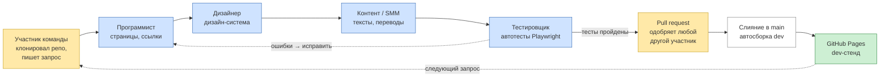
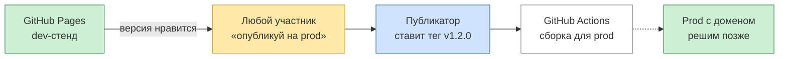

# Схема агентской разработки сайта

Интерактивная версия (Whiteboard): https://claude.ai/artifact/7zBXwEwTpg9fuTUNB5FFuS

Связанный документ: `docs/tech-stack-decision.md`

Запросы может писать любой участник команды, который склонировал репозиторий. Агенты, правила и документация лежат в репозитории.

## Разработка → dev-стенд

## Релиз на prod

Откат: «опубликуй v1.1.0» — GitHub Actions выкладывает старый тег.

Легенда: жёлтый — участник команды, синий — агенты, белый — автоматика GitHub, зелёный — сайт онлайн.

## Что лежит в репозитории
- `CLAUDE.md` — общие правила агентов
- `.claude/agents/` — описания агентов
- `docs/` — ТЗ, решения, схемы
- `src/` + `src/content/` — код и контент сайта

## Стек
Astro · Markdown в Git · Tailwind CSS · Astro i18n · Playwright · GitHub Actions · GitHub Pages (dev, $0) · prod — решим позже
